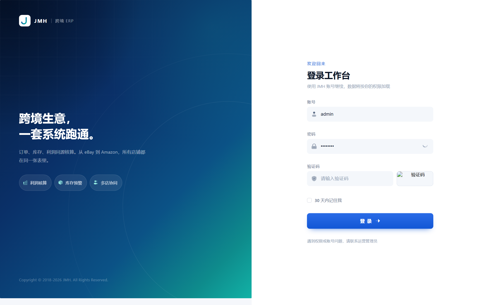
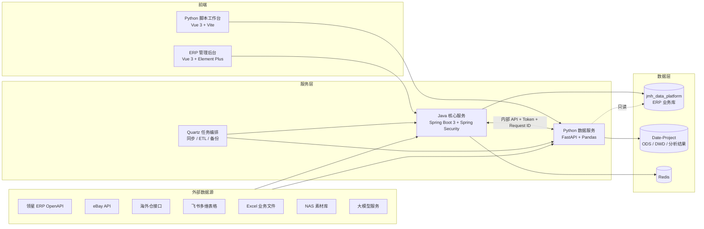
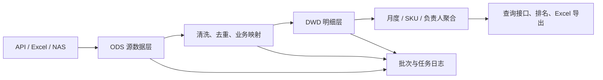
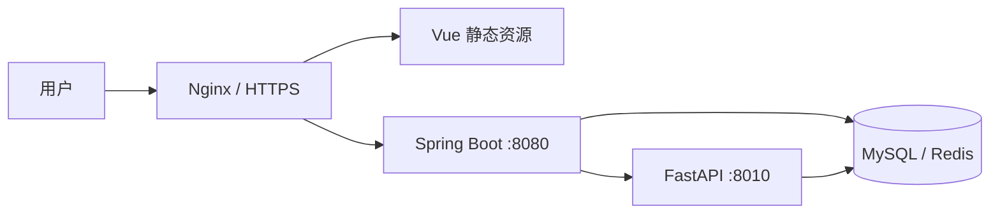

<div align="center">

# JMH Data Platform

### 跨境电商 ERP 与数据中台

面向 Amazon、eBay 多平台业务，覆盖数据同步、补货决策、利润与绩效分析、库存治理、报关退税与 AI 助手的全栈系统。


</div>



<!--
  截图占位：把图片放进 docs/images/ 后，删除本注释的首尾两行即可显示。
  建议文件名与内容：
  
  
  
  
  
  
  
  
-->

## 项目介绍

JMH Data Platform 是为跨境电商真实业务搭建的一套 ERP 与数据中台。它以管理后台为统一入口，把领星 ERP、eBay、海外仓、飞书多维表格、Excel 业务文件、NAS 素材库和大模型服务接进同一套系统，让运营、财务、供应链和管理层在一个地方看数、做决策、导出交付。

它不是一个增删改查后台，而是围绕业务流程做成了闭环：

> 多源数据采集 → 清洗与分层 → 业务规则计算 → 人工审核 → 可视化分析 → Excel 交付 → 定时调度与日志追踪

架构上采用 **Java + Python 双后端**：Java 负责认证、权限、核心业务与任务编排；Python 负责 ETL、Excel 解析、数据分析与 AI。两个服务通过内部令牌和请求 ID 通信，各自连接自己的业务库。

## 功能说明

### 运营中心

| 模块 | 功能 |
|---|---|
| Amazon 补货 | 拉取领星补货建议，按美国 / 欧洲分组展示，毛利润测算，公式可配置 |
| FBA 货件 | 货件号映射、物流费用明细批量导入、装箱信息按"货件号 + 箱号"聚合，支持混装 |
| eBay 补货 2.0 | 销量预测、分层展示、安全库存与在途计算，接入采购物流状态，按规则导出 |
| eBay 库存明细 | 库龄、货值、产品等级、历史透视，多选筛选与列说明 |
| eBay 价格分析 | 刊登价格分层（人民币 / 美元）、竞品价格跟踪、BI 视图 |
| eBay 数据报表 | 周五数据、SKU 分析、退货概览与明细 |
| 混销分析 | 同一 SKU 在 Amazon 与 eBay 的销量、库龄、价格对照 |
| 报关业务 | 报关商品与库存、费用明细、装箱信息，按模板生成报关单与合同 |
| 数据同步 | 领星、eBay、海外仓、飞书的同步任务编排，批次日志与失败告警邮件 |

### 财务中心

| 模块 | 功能 |
|---|---|
| 销售看板 | 多平台销售额、订单量、趋势图，历史数据接入 |
| 绩效排名 | 按月聚合 Amazon 与 eBay 利润，通过负责人规则映射归属，支持综合排名与源数据导出 |
| 项目利润总表 | 按 eBay / EU / US 分组汇总各主体利润，店铺运营费自动取数 |
| 月度利润表 | Amazon、eBay 月度利润明细 |
| 月度库存报表 | 期初库存、采购在途、销量与库龄成本的月度快照 |
| 滞销清货 | FBA 库龄 91–180 天、181 天以上库存的成本与差值，按区域和负责人展示 |
| 出口退税 | 批量解析报关单、采购发票、外汇回款，生成出口明细与 FIFO 进货明细 |

### AI 与自动化

- **AI 助手**：后台顶部抽屉式对话入口。Python 服务统一管理模型配置、工具调用和提示词，前端不接触密钥；回答基于只读数据工具和业务知识，并做事实约束。
- **Image SOP**：串联 Listing 资料、NAS 素材、AI 卖点分析、图片处理和 Excel 交付，把图片内容生产标准化。
- **竞品查询**：按 eBay 链接采集商品信息，结合成本、重量、汇率实时测算利润率。
- **售后归因**：规则分类优先、AI 辅助兜底、人工审核确认。

### 系统管理

用户、角色、菜单、字典、参数、通知、操作日志、定时任务、在线用户与服务监控；菜单、按钮、接口三级权限控制（RBAC）。

## 技术栈

| 领域 | 技术 |
|---|---|
| ERP 前端 | Vue 3.5、Vite 6、Element Plus、Pinia、Vue Router、Axios、ECharts |
| 脚本工作台 | Vue 3、Vite；Image SOP 以独立页面嵌入 |
| Java 后端 | Java 17、Spring Boot 3.5、Spring Security + JWT、MyBatis、PageHelper、Quartz、Druid |
| Python 后端 | Python 3.11+、FastAPI、Pydantic、Pandas、OpenPyXL、HTTPX、Pillow |
| 数据与缓存 | MySQL 8+、Redis；ODS / DWD 数据分层 |
| 文件处理 | Apache POI、OpenPyXL、Excel 模板、图片嵌入、ZIP 打包 |
| 外部集成 | 领星 OpenAPI、eBay API、海外仓接口、飞书多维表格、DeepSeek / 通义千问、Synology NAS |
| 工程化 | Maven、npm、pytest、JUnit、Node Test、Nginx、Windows Service |

## 系统架构



### 数据处理



- **幂等与增量**：通过唯一键、覆盖窗口和 upsert 避免重复导入；月度快照可单独重建。
- **源数据与业务数据解耦**：ODS 保留可追溯输入，DWD 保存清洗后的标准结构。
- **规则可解释**：负责人归属、区域拆分、售后分类和利润公式都由明确规则驱动。
- **全程可追踪**：同步批次、任务运行、请求 ID、处理数量和异常原因形成审计链路；Java 与 Python 日志用 Request ID 串联。
- **部分成功**：批量导入单项失败不影响其他项，失败项可单独修复后重传。

## 安装与运行

### 环境要求

| 依赖 | 版本 |
|---|---|
| JDK | 17 |
| Maven | 3.9+ |
| Node.js | 20+ |
| Python | 3.11+ |
| MySQL | 8+ |
| Redis | 5+ |

### 1. 初始化数据库

创建两个库并导入结构：

```sql
CREATE DATABASE jmh_data_platform DEFAULT CHARACTER SET utf8mb4;
CREATE DATABASE `Date-Project` DEFAULT CHARACTER SET utf8mb4;
```

```bash
mysql -u root -p jmh_data_platform < RuoYi-Vue-springboot3/sql/jmh_data_platform.sql
```

```bash
mysql -u root -p Date-Project < Date-Project/backend/schema.sql
```

随后按文件名日期顺序执行 `RuoYi-Vue-springboot3/sql/` 与 `Date-Project/migrations/` 下的增量脚本（菜单、权限、定时任务与数据表）。

### 2. 启动 Python 数据服务

```bash
cd Date-Project
python -m venv .venv
.venv\Scripts\python.exe -m pip install -r backend\requirements.txt
copy .env.example .env
```

编辑 `.env`，填入数据库账号、内部令牌以及需要用到的第三方服务配置，然后启动：

```bash
.venv\Scripts\python.exe -m uvicorn backend.main:app --host 0.0.0.0 --port 8010
```

健康检查：`http://127.0.0.1:8010/api/v1/health`

### 3. 启动 Java 核心服务

所有敏感配置都通过环境变量注入，常用的有：

| 环境变量 | 说明 |
|---|---|
| `DB_USERNAME` / `DB_PASSWORD` | MySQL 账号与密码 |
| `TOKEN_SECRET` | JWT 签名密钥，请改为足够长的随机串 |
| `DRUID_PASSWORD` | Druid 监控页密码 |
| `PYTHON_INTERNAL_API_TOKEN` | Java 调用 Python 的内部令牌，与 Python 的 `.env` 保持一致 |
| `LINGXING_APP_ID` / `LINGXING_APP_SECRET` | 领星 OpenAPI 凭证（可选） |
| `EBAY_CLIENT_ID` / `EBAY_CLIENT_SECRET` | eBay 应用凭证（可选） |
| `GOODCANG_APP_TOKEN` / `GOODCANG_APP_KEY` | 海外仓接口凭证（可选） |

```bash
cd RuoYi-Vue-springboot3
mvn -pl ruoyi-admin -am spring-boot:run
```

默认地址：`http://127.0.0.1:8080`

### 4. 启动 ERP 前端

```bash
cd RuoYi-Vue3-master
npm install
npm run dev
```

默认地址：`http://127.0.0.1:5173`

### 5. 启动脚本工作台（可选，开发模式）

```bash
cd Date-Project/frontend
npm install
npm run dev
```

生产环境由 Python 服务托管构建产物，入口为 `http://127.0.0.1:8010/script-tools/`。

### 运行测试

```bash
cd Date-Project
.venv\Scripts\python.exe -m pytest tests -q
```

```bash
cd RuoYi-Vue-springboot3
mvn test
```

### 生产部署

推荐用 Nginx 承载前端静态资源并反向代理两个后端：



`Date-Project/deploy/windows/` 下提供了把 Python 服务注册为 Windows 服务的脚本。

## 项目结构

```text
JMH-Date-Platform/
├─ RuoYi-Vue3-master/              # ERP 管理前端（Vue 3）
│  ├─ src/views/finance/           # 财务中心：看板、绩效、利润、库存报表、清货、退税
│  ├─ src/views/operations/        # 运营中心：Amazon、eBay、混销、报关、同步
│  ├─ src/views/sop/               # 竞品查询、脚本工具入口
│  └─ src/views/system/            # 用户、角色、菜单、任务与日志
│
├─ RuoYi-Vue-springboot3/          # Java 核心服务（Spring Boot 3）
│  ├─ ruoyi-admin/                 # API、任务入口、Java → Python 代理
│  ├─ ruoyi-system/                # 业务服务、第三方同步、计算、Mapper
│  ├─ ruoyi-quartz/                # 定时任务与调度
│  ├─ ruoyi-framework/             # 安全、Web 与基础框架
│  └─ sql/                         # 建表、菜单、权限与任务脚本
│
└─ Date-Project/                   # Python 数据与 AI 服务
   ├─ backend/api/                 # FastAPI 路由
   ├─ backend/services/            # ETL、绩效、利润、库存、补货等服务
   ├─ backend/repositories/        # 数据访问层
   ├─ backend/integrations/        # 领星、飞书等外部平台适配
   ├─ backend/agent/               # AI 助手：路由、工具、事实约束、评估
   ├─ backend/image_sop/           # Image SOP 模块
   ├─ frontend/                    # 脚本工作台（Vue 3）
   ├─ migrations/                  # 数据仓库迁移脚本
   └─ tests/                       # pytest 用例
```

## 说明

- 本项目来源于真实企业业务场景。仓库不包含任何生产账号、密码、第三方平台密钥和业务数据；人员姓名、店铺名、公司主体等标识已替换为示例值。
- 管理后台基于开源项目 [RuoYi-Vue](https://gitee.com/y_project/RuoYi-Vue) 的权限与脚手架进行二次开发，业务模块、数据服务与 AI 部分为自行设计实现。
